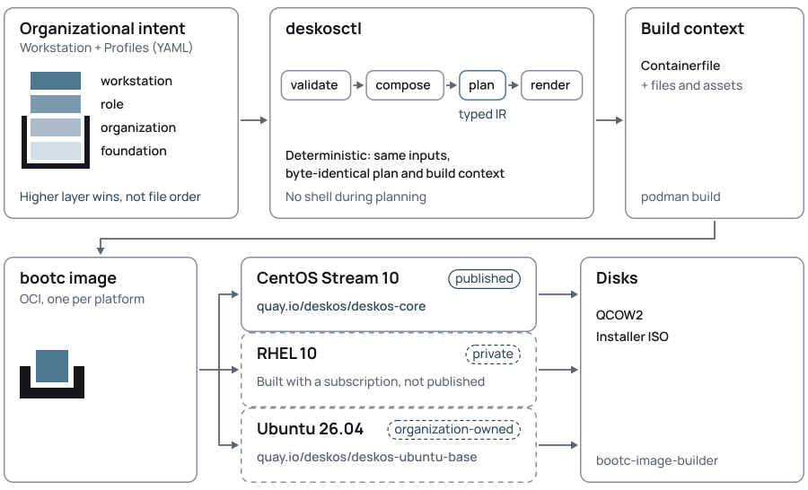

<p align="center">
  <picture>
    <source media="(prefers-color-scheme: dark)" srcset="docs/images/deskos-lockup-dark.svg">
    
  </picture>
</p>

<p align="center"><strong>Managed Linux workstations, built like infrastructure.</strong></p>

<p align="center">
  <a href="https://github.com/deskosproject/deskos-core/actions/workflows/ci.yml"></a>
  <a href="https://github.com/deskosproject/deskos-core/actions/workflows/vm-bootcheck.yml"></a>
  <a href="https://github.com/deskosproject/deskos-core/releases/latest"></a>
  <a href="LICENSE"></a>
</p>

**DeskOS is an open workstation artifact factory.** An organization describes
its workstation as *declarative resources* — applications, desktop settings,
branding, boot appearance — and DeskOS **compiles** them, deterministically,
into a bootc operating-system image:

```text
YAML → validate → compose → plan → Containerfile → bootc image → disk
```

The same intent compiles onto five platforms today. They differ in who owns the
base and how far DeskOS has validated the result:

| Platform | Base | What you can do today |
|---|---|---|
| CentOS Stream 10 | vendor | build it and boot it yourself; nothing is published yet |
| RHEL 10 | vendor (entitled) | build it privately, with a subscription; never published |
| AlmaLinux 10 | vendor (experimental) | built and booted in CI; no published image |
| Ubuntu 26.04 | the DeskOS project | built and booted in CI; no published image and no ISO — write a disk with `bootc install to-disk` |
| Fedora 44 | vendor | composes, renders and builds; not booted here yet; no published image |

The full matrix — base owner, evidence, and how to install each — is in
[**docs/platforms.md**](docs/platforms.md).

> [!NOTE]
> **Pre-1.0.** The resource APIs are `v1alpha1` and will change; see
> [Migrating](docs/roadmap.md).

> **A workstation is compiled from organizational intent.**

## Why it exists

An organization with more than a handful of Linux desktops ends up with
**snowflakes**: each machine was installed once, by hand, and then drifted.
Nobody can say what is on them, reproduce one, or prove one is safe to ship.
DeskOS takes the machine definition out of each installer's hands: you
**describe** the workstation in versioned text, and DeskOS **compiles** it into
one image — built, tested, signed and published like any other artifact in your
pipeline.

## The five-minute tour

### The four words

- **Resource** — a YAML file describing one thing: a package set, a repository,
  a desktop setting, a theme, an update policy. There are **fourteen kinds**;
  each is small and composable. See [docs/resources.md](docs/resources.md).
- **Profile** — a named group of resources at a **layer**:
  `foundation` < `organization` < `role` < `workstation`. A higher layer
  overrides a lower one *on purpose*, never by file order.
- **Workstation** — the machine: a platform plus the profiles it is made of.
  This is the file you author.
- **Plan, then render** — the compiler reads every resource, composes them into
  a typed **plan** (each value keeps the resource and layer it came from), and
  `render` writes a deterministic build context: the same inputs always give the
  same bytes.

### See it work

Get `deskosctl` (step 1 of the [Quickstart](#quickstart)) and look at the
workstation Core already ships — no files to write yet:

```console
$ ./deskosctl validate
ok: 1 workstation(s) compose cleanly: deskos-core-centos10

$ ./deskosctl plan --workstation deskos-core-centos10
WORKSTATION
  deskos-core-centos10 (DeskOS Core (CentOS Stream 10))

PLATFORM
  CentOS Stream 10 (centos-stream-10)
  base image: quay.io/centos-bootc/centos-bootc:stream10 (pinned sha256:98cb9980…)
  publication: redistributable

PROFILES
  foundation:  deskos-core
  foundation:  deskos-look
  foundation:  deskos-reference-apps
  foundation:  rhel-family

ARTIFACT
  RPM repositories
    none
  Package groups
    workstation  -> workstation-product-environment (without setroubleshoot, …)
  Packages
    firefox                 [foundation PackageSet/rhel-family]
    firewalld               [foundation PackageSet/rhel-family]
    …
```

`plan` prints what the image will contain and **where each value came from**. To
author your own machine, copy the
[example organization](https://github.com/deskosproject/deskos-core/tree/main/examples/baseline-and-role)
— a `Workstation` plus the profiles it is made of — and point `deskosctl` at that
directory. Building the image and a disk needs `podman` and root; that is the
rest of the [Quickstart](#quickstart).

## Quickstart

The whole flow, which is the render → build → disk flow CI runs:

```bash
# 1. Get deskosctl (one binary; no Go toolchain needed).
curl -fLO https://github.com/deskosproject/deskos-core/releases/latest/download/deskosctl-linux-amd64
curl -fLO https://github.com/deskosproject/deskos-core/releases/latest/download/SHA256SUMS
sha256sum -c --ignore-missing SHA256SUMS
mv deskosctl-linux-amd64 deskosctl && chmod +x deskosctl

# 2. Look at the workstation Core ships — no files to write yet.
./deskosctl validate
./deskosctl plan --workstation deskos-core-centos10

# 3. Render the build context and build the image (needs podman and root).
./deskosctl render --workstation deskos-core-centos10 --output ctx
sudo podman build -t localhost/deskos-core-centos10:test ctx

# 4. Optional: a QCOW2 disk from that image.
sudo podman run --rm --privileged --pull=missing \
    --security-opt label=type:unconfined_t \
    -v ./output:/output -v /var/lib/containers/storage:/var/lib/containers/storage \
    quay.io/centos-bootc/bootc-image-builder@sha256:2b52843ea2bfda73b0a08d97e76b734393b1d3a804681b9fabb26723bd3a2f0b \
    build --type qcow2 --no-default-kernel-args localhost/deskos-core-centos10:test
```

The image is published **per platform**, one repository each, by `supply-chain.yml`
with `publish=true`: `quay.io/deskos/deskos-core-centos10`, `-almalinux10`, and so on.
No dispatch has run yet, so **nothing is published today**, and the older single
repository (`quay.io/deskos/deskos-core`) has been withdrawn. Rendering is deterministic — the same inputs
give byte-identical output, and `generated-manifest.json` records their SHA-256 —
so the build context is reproducible from the same commit. The image **build is
not** yet bit-for-bit reproducible: the base tag and repository content can move
between builds (see [supply-chain inputs](docs/architecture.md#supply-chain-inputs)).

Disks: [docs/install.md](docs/install.md) covers QCOW2, the Anaconda ISO, the
private RHEL build, and the Ubuntu `bootc install to-disk` path. The canonical
status of each platform, and what is verified, is in
[docs/platforms.md](docs/platforms.md).

## How it works

<p align="center">
  <picture>
    <source media="(prefers-color-scheme: dark)" srcset="docs/images/deskos-flow-dark.svg">
    
  </picture>
</p>

*(The figure predates AlmaLinux 10; the platform list is above and in
[docs/platforms.md](docs/platforms.md).)*

A `Workstation` names a **platform** and the **profiles** it is made of:

```yaml
apiVersion: core.deskos.org/v1alpha1
kind: Workstation
metadata:
  name: example-devops-centos10
spec:
  platformRef: centos-stream-10
  profiles:
    - deskos-core        # foundation, shipped by DeskOS
    - example-baseline   # organization
    - example-devops     # role
```

`deskosctl plan` shows the composed workstation *before anything is built*, and
`deskosctl render` writes the deterministic build context. A `Workstation` is the
resource you author: a machine definition that compiles into a workstation
**image** (a bootable container image). Every resource kind, with an example, is
in [**docs/resources.md**](docs/resources.md).

## Composition

<p align="center">
  <picture>
    <source media="(prefers-color-scheme: dark)" srcset="docs/images/deskos-composition-dark.svg">
    
  </picture>
</p>

Profiles sit at explicit layers, `foundation` < `organization` < `role` <
`workstation`, so an organization overrides DeskOS Core **on purpose**, never by
file order. Here the organization shortens Core's screen blank from `10m` to `5m`:

```yaml
apiVersion: desktop.deskos.org/v1alpha1
kind: GnomeProfile
metadata:
  name: example-desktop      # included by example-baseline (organization)
spec:
  defaults:
    session:
      idle:
        blankAfter: 5m       # wins over Core's 10m
    dock:
      position: bottom
```

- **Sets** (packages, units) are unioned.
- **Scalars** (GNOME settings) take the highest layer; two different values *at
  the same layer* are an error.
- **Keyed** definitions (repositories, Flatpaks, binaries) must agree.

Every value in the plan keeps its *provenance*: the resource, layer and file it
came from.

## What DeskOS is not

- **Not a distribution with editions.** Organizations compose their own
  workstations from DeskOS Core, their baseline and their roles.
- **Not configuration management.** DeskOS owns the *image*, not the running
  machine; Ansible, Satellite, MDM and EDR keep managing endpoints.
- **Not a developer environment manager.** Personal tooling (Homebrew, mise,
  dotfiles, Toolbox contents) stays outside the managed baseline.

## Status

Pre-1.0 and experimental: the resource APIs are `v1alpha1` and will change.
DeskOS publishes **one repository per platform** (`deskos-core-centos10`,
`-almalinux10`, …), and nothing has been published yet. The platform matrix, with what is
verified on each and how to install it, is [**docs/platforms.md**](docs/platforms.md).

> [!IMPORTANT]
> **RHEL 10 images are never published.** Organizations with RHEL subscriptions
> build them privately and keep them inside the organization (the RHEL EULA
> forbids public redistribution);
> see [docs/install.md](docs/install.md#rhel-10-private-builds-only).

## Documentation

By what you want to do:

| | |
|---|---|
| **Evaluate** | the tour above; [**Platforms**](docs/platforms.md) for status and installation per platform; [**Architecture**](docs/architecture.md) for the pipeline and design principles |
| **Create and install** | [**Installing DeskOS**](docs/install.md): QCOW2 and ISO from the image you build; private RHEL 10 builds; AlmaLinux 10; Fedora 44; the Ubuntu 26.04 `bootc install to-disk` path |
| **Operate an installed machine** | [**Operations**](docs/operations.md): how updates stage, apply and roll back |
| **Define resources** | [**Resources**](docs/resources.md): every kind with an example; composition; software and GNOME model |
| **Develop** | [**Development**](docs/development.md): build `deskosctl`, run the tests, cut a release |
| **Audit the supply chain** | [**Supply chain**](docs/supply-chain.md): SBOM, scan, exceptions, signing; [ADRs](docs/adr/) and their [index](docs/adr/README.md) |
| **Track** | [Roadmap](docs/roadmap.md) · [Research notes](docs/research-notes.md) · the [harness](tests/vm/README.md) |

## License

**Code:** [Apache License 2.0](LICENSE).
**DeskOS artwork** (`resources/assets/deskos/`, `docs/images/`): CC BY-SA
4.0; see [PROVENANCE.md](resources/assets/deskos/PROVENANCE.md).
