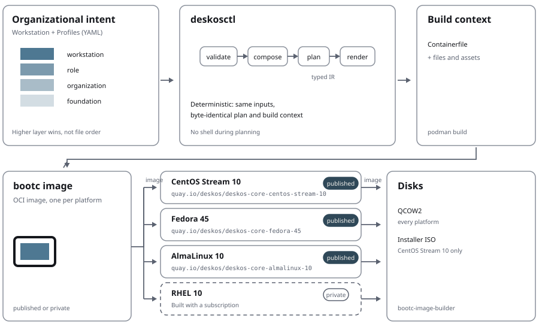

<p align="center">
  <picture>
    <source media="(prefers-color-scheme: dark)" srcset="docs/images/deskos-lockup-dark.svg">
    
  </picture>
</p>

<p align="center"><strong>Managed Linux workstations, built like infrastructure.</strong></p>

<p align="center">
  <a href="https://github.com/deskosproject/deskos-core/actions/workflows/checks.yml"></a>
  <a href="https://github.com/deskosproject/deskos-core/actions/workflows/image-bootcheck.yml"></a>
  <a href="LICENSE"></a>
</p>

DeskOS compiles a workstation from text. You describe it in YAML resources
(applications, desktop settings, branding, update policy) and get one bootable
Linux image.

The product is your golden image, not our published one. The CentOS Stream 10
image exists so you can try it today; a template repository gets you your own
image with a fork and one workflow.

<p align="center">
  <picture>
    <source media="(prefers-color-scheme: dark)" srcset="docs/images/deskos-flow-dark.svg">
    
  </picture>
</p>

A workstation is one file:

```yaml
apiVersion: core.deskos.org/v1alpha1
kind: Workstation
metadata:
  name: example-devops-centos-stream-10
spec:
  platformRef: centos-stream-10
  profiles: [deskos-core, deskos-gnome, example-organization, example-devops]
```

Profiles sit at four layers: `foundation`, `organization`, `role`, `workstation`.
A higher layer overrides a lower one on purpose, never because of file order.
Sets union, keyed definitions must agree, and a scalar takes the highest layer.
The Plan records where every value came from.

## Start

| I want to | Do this |
|---|---|
| Build my own image | Use [`deskos-template-cs10`](https://github.com/deskosproject/deskos-template-cs10): edit four YAML files, one workflow builds on a GitHub-hosted runner and pushes to `ghcr.io`. The package starts private. |
| Build on RHEL 10 | Fork [`deskos-template-rhel10`](https://github.com/deskosproject/deskos-template-rhel10) privately; it builds on your entitled runner into your registry. |
| Run the compiler here | `deskosctl validate`, `render`, then `podman build`. See the three commands below. |
| Try the published image | `sudo bootc switch quay.io/deskos/deskos-core-centos-stream-10:stable`, then reboot. Evaluation only. |
| Install on a disk | Turn the image into a QCOW2 or an ISO: [install.md](docs/install.md). |

```bash
./bin/deskosctl validate ./examples/centos-stream-10
./bin/deskosctl render ./examples/centos-stream-10 \
    --workstation example-centos-stream-10 \
    --output ./dist/centos
sudo podman build -t localhost/deskos-centos:test ./dist/centos
```

`deskosctl` is one binary from
[Releases](https://github.com/deskosproject/deskos-core/releases), with no Go
toolchain needed. Every kind, with an example, is in
[resources.md](docs/resources.md).

## What the build checks

Every weekly build runs this sequence and publishes nothing unless all of it
passes:

| Check | What it proves |
|---|---|
| Compile and render | the same resources produce the same Plan and build context |
| Image build and lint | the image builds from a pinned base and passes `bootc container lint` |
| Boot | QEMU reaches a graphical screen and shuts down |
| Session | dconf, extensions, favorites, wallpaper and binaries match the Plan; the desktop exposes its applications and opens one |
| First boot | GNOME Initial Setup is the session and no account exists |
| Update and rollback | a real install moves A to B and back, survives a power loss during the deployment write and after the staged entry is active, and recovers a candidate that cannot boot |
| Domain login | a throwaway FreeIPA realm and a Samba AD domain, joined at first boot |
| Supply chain | installed SBOM, CVE scan, signature and provenance on the digest |

Results are keyed by digest at <https://evidence.deskos.org> and summarised at
<https://deskos.org/evidence/>. Boot, session and first-boot checks also run on
every merge to `main` that can change an image; screenshots are in
[qa.md](docs/qa.md).

Update and rollback are tested on a real installed disk, not inferred from unit
tests: the lifecycle run stages B, boots it, rolls back to A, injects a power
loss in the deployment write and again after the staged entry is active, and
recovers a candidate that cannot boot. It keeps deployment identities, `/var`
and `/etc` state, and per-boot journals. See
[design/lifecycle.md](docs/design/lifecycle.md).

## Platforms

| Platform | Today |
|---|---|
| CentOS Stream 10 | published image, installer ISO, all checks on every weekly build |
| RHEL 10 | composes and renders here; the entitled build runs in the organization that owns the subscription and is never published |
| AlmaLinux 10 | published image; Core publishes no installer |
| Fedora 45 | published image; Core publishes no installer, a downstream organization does |

The full matrix, with what is and is not verified, is
[platforms.md](docs/platforms.md).

## What DeskOS is not

| It is not | Because |
|---|---|
| a distribution with editions | organizations compose their own workstations from Core, their baseline and their roles |
| configuration management | DeskOS owns the image, not the running machine; Ansible, Satellite, MDM and EDR keep managing endpoints |
| a developer environment manager | personal tooling stays outside the managed baseline |
| a way to publish RHEL images | the EULA forbids redistribution; organizations build them privately |

## Read more

| | |
|---|---|
| Install a machine | [install.md](docs/install.md) |
| Operate one | [operations.md](docs/operations.md), [recovery.md](docs/recovery.md) |
| Fix a machine | [troubleshooting.md](docs/troubleshooting.md) |
| Choose a platform | [platforms.md](docs/platforms.md) |
| Understand the model | [architecture.md](docs/architecture.md), [runtime.md](docs/runtime.md) |
| Write resources | [resources.md](docs/resources.md) |
| Audit the supply chain | [supply-chain.md](docs/supply-chain.md) |
| Contribute | [CONTRIBUTING.md](CONTRIBUTING.md), [development.md](docs/development.md) |
| What is next | [roadmap.md](docs/roadmap.md), [ADRs](docs/adr/README.md) |

## License

Code: [Apache License 2.0](LICENSE). DeskOS artwork (`resources/assets/deskos/`,
`docs/images/`): CC BY-SA 4.0, see
[PROVENANCE.md](resources/assets/deskos/PROVENANCE.md).
