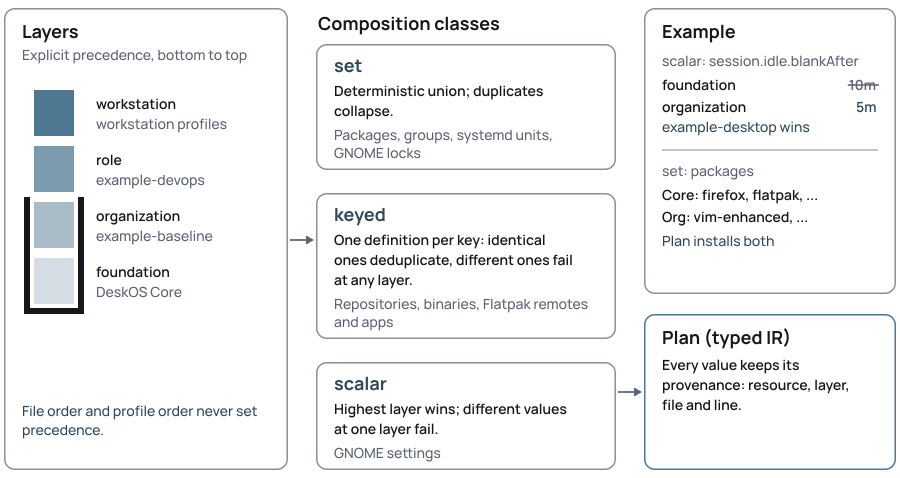

# Resources

The DeskOS resource model: every kind with a real example from this
repository, how layers compose, and the software and GNOME model behind
them.

## Envelope

DeskOS configuration uses **versioned, Kubernetes-inspired resource
envelopes**. DeskOS borrows the useful API ideas (Group, Version, Kind,
schemas and composition) *without requiring Kubernetes*.

```yaml
apiVersion: core.deskos.org/v1alpha1
kind: Workstation
metadata:
  name: example-developer-centos10
spec:
  platformRef: centos-stream-10
  profiles:
    - deskos-core
    - example-baseline
    - example-developer
```

| Group | Kinds |
|---|---|
| `core.deskos.org` | `Platform`, `Profile`, `Workstation` |
| `software.deskos.org` | `PackageSet`, `RpmRepository`, `AptRepository`, `BinaryArtifact`, `FlatpakRemote`, `FlatpakSet` |
| `desktop.deskos.org` | `GnomeProfile`, `Theme` |
| `system.deskos.org` | `BootProfile`, `UpdatePolicy`, `TrustAnchor` |

All kinds are `v1alpha1`. Their JSON Schemas are in
[`schemas/`](../schemas/).

## Resource roots

Resources live in YAML files under **one or more resource roots**. DeskOS
Core is **embedded in `deskosctl`** and loaded by default; an organization
keeps its own root and references Core resources by kind and name
**without copying them**. `--no-core` drops the embedded Core, to compile
against a Core tree you pass, and `deskosctl core export DIR` writes it out.

- File and directory names have no meaning.
- Asset paths are relative to the YAML file.
- Every example below is a file from this repository
  ([`resources/`](../resources/) and
  [`examples/baseline-and-role/`](../examples/baseline-and-role/)), except the
  `BinaryArtifact` desktop entry example.

## Resource kinds

### `Workstation`

A concrete build target: **one platform plus profiles**. Profile order is
*not* precedence. It compiles into a workstation **image**; `Workstation`
is the composition kind — the machine you author — not a Fedora edition.

```yaml
apiVersion: core.deskos.org/v1alpha1
kind: Workstation
metadata:
  name: example-devops-centos10
spec:
  displayName: Example DevOps Workstation
  platformRef: centos-stream-10
  profiles:
    - deskos-core
    - example-baseline
    - example-devops
```

`deskosctl plan ./examples/baseline-and-role --workstation
example-devops-centos10` shows the composed result, including **which
layer won each setting**.

### `Profile`

Places resources at **one semantic layer**:

```yaml
apiVersion: core.deskos.org/v1alpha1
kind: Profile
metadata:
  name: example-baseline
spec:
  layer: organization
  description: Example organization baseline for every workstation.
  resources:
    - kind: PackageSet
      name: example-baseline
    - kind: GnomeProfile
      name: example-desktop
```

### `Platform`

Facts about an OS target: its bootc base image, **its package manager** (`rpm` or
`deb`), its package-group mapping, GNOME, boot, image update and Flatpak
capabilities, and its redistribution constraints. DeskOS ships `centos-stream-10`,
`rhel-10` and `ubuntu-2604` in [`resources/platforms/`](../resources/platforms/); see
[architecture.md](architecture.md#core-organizations-and-roles).

A package-group mapping names the platform's own members: `rpmGroups` for an RPM
platform, `members` (its metapackage names) for a deb one. A platform declares one
or the other, according to its package manager. `rpmFiles`, `RpmRepository` and
`AptRepository` are each one manager's: a platform whose manager is not that one
fails at compile time when any of them is requested, instead of rendering nonsense
or copying files where nothing reads them.

**A package or tool name belongs to a platform, never to Core.** When Core needs a
program the platform may spell differently, the platform declares it: `flatpak.package`
for the application channel, `trust.updateCommand` for the trust store, and
`iconCache.package` with `iconCache.command` for the tool that refreshes an icon
theme cache. Core carries no name of its own and no table translating one platform's
name into another's — a table has to be maintained per platform pair, and it gets
worse with every platform added. A platform that declares nothing where a name is
needed reports the gap at compile time (invariant 9): a desktop entry with an icon
on a platform with no `iconCache` fails composition, rather than shipping an icon
that never appears.

### `PackageSet`

Packages, RPM groups (named by the Platform) and units to enable:

```yaml
apiVersion: software.deskos.org/v1alpha1
kind: PackageSet
metadata:
  name: deskos-core
spec:
  groups:
    - workstation
```

The foundation names its own metapackage group and no individual packages: the
vendor's base already carries what a desktop needs (measured: `NetworkManager` is in
both bases, so naming it installed nothing, and naming it forced Core to know one
family's spelling of it). A browser, a firewall and an application channel are
platform or organization choices: the RHEL family keeps its browser, its firewall
and its application channel in `PackageSet/rhel-family`, which workstations on those
platforms add through `Profile/rhel-family`. They cannot live in the foundation,
because composition unions sets and offers no removal (ADR 0003), so every platform
would be forced to carry them (ADR 0014).

Naming nothing has a price worth stating: nothing here asserts that a platform's
base carries what a desktop needs, so "the base has NetworkManager" became a fact to
check per base rather than a requirement the model enforces. That check belongs to
whoever validates a base digest, not to the foundation.

`rpmFiles` installs **signed RPMs that the vendor publishes without a
repository**. Each entry needs an https URL that is not a floating
location, the file's SHA-256 and `gpgKeyFile`, the vendor's ASCII-armored
public key as a file inside the resource root, relative to the YAML file.
The build fails unless the checksum matches and the RPM is signed by that
key. Identical entries from several resources deduplicate; the same URL
with another checksum or key is a conflict at any layer.

An example for Zoom (organization content, not part of DeskOS; the
organization provides `keys/zoom.asc`, here the key from
`https://zoom.us/linux/download/pubkey?version=6-7-5`, fingerprint
`84C3 65D6 CC9A 4886 CA92 6BCC 4F21 9739 9706 AC24`):

```yaml
apiVersion: software.deskos.org/v1alpha1
kind: PackageSet
metadata:
  name: zoom
spec:
  rpmFiles:
    - url: https://zoom.us/client/7.2.1.5760/zoom_x86_64.rpm
      sha256: 79b6fc1ffd9fd2e2d136e898aed9c8ed6ab672a83841de4220ca4c14005d76fd
      gpgKeyFile: keys/zoom.asc
```

A set also names the **sources its packages need**, and the reference is typed like
the repository it names: `repositories` names `RpmRepository` resources and
`aptRepositories` names `AptRepository` resources. Either includes that repository
in the image. Neither pins which repository a package is resolved from: that stays
the package manager's own resolution and priority order at build time, on both
managers, and a package the vendor also ships elsewhere can still come from there.
A set that names the other manager's kind is included, and fails once the
platform's manager is known, with that reason.

### `RpmRepository`

An **official vendor repository**:

```yaml
apiVersion: software.deskos.org/v1alpha1
kind: RpmRepository
metadata:
  name: vscode
spec:
  id: code
  displayName: Visual Studio Code
  baseURL: https://packages.microsoft.com/yumrepos/vscode
  gpgKeyFiles:
    - keys/microsoft.asc
```

The signing keys are **local assets**, read into the plan and placed in the
image (`/etc/pki/rpm-gpg/`), so the repository file references them by
`file://` and a dnf transaction never trusts a key fetched from the network.

### `AptRepository`

A **signed APT source**, for a platform whose package manager is apt: its suite
and components, the architectures it serves, and the vendor's key.

```yaml
apiVersion: software.deskos.org/v1alpha1
kind: AptRepository
metadata:
  name: vscode
spec:
  id: vscode
  displayName: Visual Studio Code - Stable
  baseURL: https://packages.microsoft.com/repos/code
  suite: stable
  components: [main]
  architectures: [amd64]
  gpgKeyFiles:
    - keys/microsoft.asc
```

It renders as one **deb822** stanza in
`/etc/apt/sources.list.d/deskos-<id>.sources`, and its key as
`/etc/apt/keyrings/deskos-<sha256>.asc`; both are copied into the image before the
first package transaction, so a group member or a package that comes from a
declared source has the source on disk by then. `Signed-By` names the keyring, and
apt then requires that repository's own metadata to be signed by that key — an
unsigned APT source is therefore not expressible, and the rendering refuses one
with no key rather than writing a source apt would trust against every key it has.

Three of the rules come from apt, not from this project:

- **Suite and components are one decision.** apt tells them apart by the trailing
  slash: a suite that is an exact archive path ends with `/` and takes no
  components (the Kubernetes archive is the real case), and a named suite takes at
  least one.
- **The id is a file name.** apt reads only letters, digits, dots, hyphens and
  underscores in `sources.list.d`, and ignores any other name *silently*; a wider
  id is refused at compile time rather than written where nothing reads it.
- **`architectures` is optional.** Omitted, apt downloads the indexes for its own
  architecture list; named, it fetches only those.

This is the same vendor the `RpmRepository` example above declares, at that
vendor's APT endpoint — a different archive from the RPM one — expressed for the
other package manager: a repository of one manager is not a repository of another
(ADR 0015).

### `BinaryArtifact`

A verified upstream binary, **pinned by version and SHA-256**:

```yaml
apiVersion: software.deskos.org/v1alpha1
kind: BinaryArtifact
metadata:
  name: openshift-client
spec:
  version: 4.22.17
  source:
    url: https://mirror.openshift.com/pub/openshift-v4/clients/ocp/4.22.17/openshift-client-linux-amd64-rhel9-4.22.17.tar.gz
    sha256: 87f436029301f4856d3c3df85586bd34aafb807d7870939f1aa4885afdd4834f
  archive: tar.gz
  files:
    - path: oc
      destination: /usr/local/bin/oc
      mode: "0755"
```

A graphical application installed this way can declare a
**`desktopEntry`**, so it appears in the GNOME application menu and can
be added to the dock favorites. The example below is organization
content, not a file of this repository; this Ghostty AppImage is a
community build, not an official Ghostty release:

```yaml
apiVersion: software.deskos.org/v1alpha1
kind: BinaryArtifact
metadata:
  name: ghostty
spec:
  version: 1.3.1
  source:
    url: https://github.com/pkgforge-dev/ghostty-appimage/releases/download/v1.3.1/Ghostty-1.3.1-x86_64.AppImage
    sha256: fde48d2b716afd1978766879bbf1aae30dd305e8ad86a1037a2614a14d82dc28
  archive: none
  files:
    - destination: /usr/local/bin/ghostty
      mode: "0755"
  desktopEntry:
    id: com.mitchellh.ghostty
    name: Ghostty
    comment: Fast, native terminal emulator
    icon: ../assets/ghostty.png
    categories: [System, TerminalEmulator]
    startupWMClass: com.mitchellh.ghostty
```

| Field | Rule |
|---|---|
| `id` | reverse-DNS name (dot-separated elements of `[A-Za-z0-9_-]`, none starting with a digit); the file is `/usr/share/applications/<id>.desktop` and the icon name is `<id>` |
| `name`, `comment` | one line of text, without control characters or surrounding whitespace; `comment` is optional |
| `icon` | asset inside the resource root: a square PNG of a size the hicolor theme defines (16, 22, 24, 32, 36, 48, 64, 72, 96, 128, 192, 256 or 512 pixels), installed in `hicolor/<size>x<size>/apps/`, or an SVG, installed in `hicolor/scalable/apps/` |
| `categories` | registered freedesktop categories known to the platforms' `desktop-file-validate`, at least one of them a main category; `ConsoleOnly` is not accepted |
| `startupWMClass` | optional; matches the application's window class so the dock groups its windows under the launcher |

`Exec` and `TryExec` are **not authored**: they are the destination of
the artifact's only file, without arguments, so `desktopEntry` requires
an artifact with exactly one file. The entry also sets
`Type=Application` and `Terminal=false`. Two artifacts that declare the
same `id` conflict unless their entries are identical.

### `FlatpakRemote` and `FlatpakSet`

A **system** Flatpak remote, and applications preinstalled from it. The
`transport` field selects the repository model and defaults to `ostree`:

```yaml
apiVersion: software.deskos.org/v1alpha1
kind: FlatpakRemote
metadata:
  name: flathub
spec:
  title: Flathub
  url: https://dl.flathub.org/repo/
  collectionID: org.flathub.Stable
  gpgKeyFile: keys/flathub.gpg
```

An **OCI** remote is an index of Flatpak images in a container registry,
which flatpak reads over the `oci+https` transport. The registry and its
images carry the signatures, so an OCI remote has no `gpgKeyFile` and no
`collectionID`, and `url` stays a plain `https://` URL: DeskOS adds the
scheme. A registry that asks for credentials names its authenticator, and
the machine supplies them; the artifact never carries a token.

```yaml
apiVersion: software.deskos.org/v1alpha1
kind: FlatpakRemote
metadata:
  name: katello
spec:
  title: Katello
  transport: oci
  url: https://satellite.example.com
  authenticator: org.flatpak.Authenticator.Oci
```

DeskOS writes `/usr/share/flatpak/remotes.d/<name>.flatpakrepo`. That file
format cannot carry an authenticator, so a remote that names one also gets
a unit that points the remote at it once the remote exists. The credentials
stay on the machine, for example in `/etc/flatpak/oci-auth.json`, and are
not part of the image.

```yaml
apiVersion: software.deskos.org/v1alpha1
kind: FlatpakSet
metadata:
  name: deskos-reference-apps
spec:
  remote: flathub
  applications:
    - id: io.github.kolunmi.Bazaar
      branch: stable
```

### `GnomeProfile`

**GNOME intent** in administrator vocabulary. An organization layer
overrides the Core defaults it names:

```yaml
apiVersion: desktop.deskos.org/v1alpha1
kind: GnomeProfile
metadata:
  name: example-desktop
spec:
  defaults:
    windows:
      buttons: [close]
    appearance:
      wallpaper:
        light: ../assets/example.svg
      loginLogo: ../assets/example-login-logo.svg
      colorScheme: prefer-dark   # default | prefer-dark | prefer-light
      accentColor: teal          # blue, teal, green, yellow, orange, red, pink, purple, slate
    software:
      updates: manual            # automatic | manual | disabled
    session:
      idle:
        blankAfter: 5m
      lock:
        enabled: true
        delay: 0s
    dock:
      enabled: true
      position: bottom
      behavior: intellihide
      iconSize: 40
      showTrash: false
```

Shell, clock and keyboard settings use the same mechanism:

```yaml
spec:
  defaults:
    shell:
      hotCorners: false
      welcomeTour: true            # the first-run welcome dialog (tour)
      workspaces: 4                # dynamic | 1 to 36
      appFolders:
        - id: Development
          name: Development
          apps: [code.desktop]
          categories: [Development]
    clock:
      showWeekday: true
      format: 24h                  # 24h | 12h
    keyboard:
      numLock: true
      terminal: com.mitchellh.ghostty.desktop   # Ctrl+Alt+T
```

- **`appFolders`** replaces GNOME's built-in folders (such as
  *Utilities*); declare every folder the app grid should have. A higher
  layer replaces the whole list. Not available on RHEL 10.2, whose GNOME
  Shell 49.4 overwrites them at first login.
- **`keyboard.terminal`** binds Ctrl+Alt+T to the given desktop file
  through the Platform's application launcher (`gtk-launch` on EL10).
- **`welcomeTour`** (default `true`) controls GNOME Shell's first-run
  welcome dialog, which offers the desktop tour. `false` suppresses it.

### `Theme`

A **named, reusable look** — a palette mapped onto the surfaces GNOME
itself defines. A Theme maps a palette onto the same GNOME
setting domain as `GnomeProfile`, so it layers, locks and conflicts like
any other appearance setting:

```yaml
apiVersion: desktop.deskos.org/v1alpha1
kind: Theme
metadata:
  name: tokyo-night
spec:
  mode: dark                    # dark | light
  accent: "#7aa2f7"             # any #RRGGBB; mapped to the closest GNOME accent
  palette:                      # free colors for the GTK and terminal overrides
    background: "#1a1b26"
    foreground: "#a9b1d6"
    red: "#f7768e"              # the six normal ANSI colors also produce
    green: "#9ece6a"            # a Ptyxis terminal palette
    yellow: "#e0af68"
    blue: "#7aa2f7"
    magenta: "#ad8ee6"
    cyan: "#449dab"
  iconTheme: Yaru-blue
  cursorTheme: Adwaita
  fonts:
    monospace: { family: JetBrains Mono, size: 11 }
  wallpaper:
    light: ../assets/tokyo-night-light.svg
    dark: ../assets/tokyo-night-dark.svg
```

- **`mode`** lowers to `appearance.colorScheme` (`dark` → `prefer-dark`).
- **`accent`** is any hex; it is mapped to the closest of GNOME's nine
  accents **by hue** (a light green stays green), with a `slate` fallback
  for near-achromatic colors.
- **`palette`** makes the Theme generate named-color overrides for
  **GTK4/libadwaita and GTK3** (`/etc/skel/.config/gtk-{4,3}.0/gtk.css`), and,
  when the six normal ANSI colors are present, a **Ptyxis terminal palette**
  (`/etc/skel/.local/share/org.gnome.Ptyxis/palettes/`). Users the installer
  or GNOME Initial Setup create inherit them.
- **`wallpaper`**, **`fonts`**, **`iconTheme`** and **`cursorTheme`** are
  the same shapes and lowering as in `GnomeProfile.appearance`.

A Theme is included by a `Profile` like any other resource. A native GTK3
theme, terminals and a GNOME Shell recoloring are still out: the Shell needs
the `user-theme` extension and its own stylesheet; see
[ADR 0013](adr/0013-theme.md).

### `BootProfile`

**Boot appearance**: graphical splash, quiet boot and the splash
watermark.

```yaml
apiVersion: system.deskos.org/v1alpha1
kind: BootProfile
metadata:
  name: deskos-core
spec:
  splash: graphical
  quiet: true
  watermark: ../assets/deskos/deskos-splash-watermark.png
```

### `UpdatePolicy`

**Unattended updates** of the image and of system Flatpaks. The image
update only downloads and stages the next image; it applies at the next
reboot the user makes. Neither update reboots the machine.

```yaml
apiVersion: system.deskos.org/v1alpha1
kind: UpdatePolicy
metadata:
  name: deskos-core
spec:
  image:
    automatic: true
    schedule: daily
    requireACPower: true
  flatpak:
    automatic: true
    schedule: daily
    requireACPower: true
```

`schedule` is `daily` or `weekly`. Every field is a layered scalar, so an
organization changes one field and keeps the rest of Core's policy, for
example `image: {schedule: weekly}`, or turns image updates off with
`image: {automatic: false}` when another tool updates its machines. The
generated units are described in
[architecture.md](architecture.md#updates); how to operate them is in
[operations.md](operations.md).

### `TrustAnchor`

**Organization CA certificates** placed in the platform trust store:

```yaml
apiVersion: system.deskos.org/v1alpha1
kind: TrustAnchor
metadata:
  name: example-root-ca
spec:
  anchors:
    - name: example-root-ca
      file: ../assets/example-root-ca.crt
```

Each `file` is a PEM X.509 certificate inside the resource root and `name`
is the file stem in the trust store. Anchors are **keyed** by `name`: the
same certificate under one name deduplicates, and a different certificate
under the same name conflicts at any layer. The Platform supplies the
anchors directory and the update command; on both EL10 platforms that is
`/etc/pki/ca-trust/source/anchors/` and `update-ca-trust`. The private key
is neither needed nor accepted. See
[architecture.md](architecture.md#trust-store).

## Composition

<p align="center">
  <picture>
    <source media="(prefers-color-scheme: dark)" srcset="images/deskos-composition-dark.svg">
    
  </picture>
</p>

A workstation is composed from **explicit semantic layers**:
`foundation` < `organization` < `role` < `workstation`.

- **DeskOS Core provides defaults**; organizations *intentionally*
  override them.
- **Conflicting settings at the same layer are errors.**
- **File order is never precedence.**

The full rules (set, keyed and scalar classes, provenance) are in
[architecture.md](architecture.md#composition).

## DeskOS Core

**DeskOS Core** is the reusable workstation foundation maintained by the
project.

- The public reference workstation uses **CentOS Stream 10**.
- Organizations that require **RHEL** compile the same Core semantics
  directly onto the official RHEL 10 bootc base.
- **AlmaLinux 10** composes the same Core on the AlmaLinux project's own
  bootc base, which the project labels experimental.
- **Ubuntu 26.04** composes the same Core on a base owned by the Project
  DeskOS, without the RHEL family's software
  ([ADR 0014](adr/0014-platform-base-ownership.md)).
- The RHEL artifact is **not derived** from the CentOS image.

## Software model

DeskOS deliberately **avoids becoming a universal package manager**. The
managed baseline uses the delivery mechanism appropriate to the
software, in this order of preference:

1. distribution RPM;
2. official vendor RPM, from its repository or, when the vendor publishes
   none, as a signed RPM file;
3. verified upstream binary;
4. system Flatpak;
5. future managed web applications.

User and project environments (mise, SDKMAN, Homebrew, language version
managers, dotfiles, personal Toolboxes) are **outside the DeskOS managed
baseline**.

## GNOME

DeskOS exposes **administrator intent**, not dconf implementation details.
An administrator describes things such as:

- window controls;
- wallpapers and branding;
- fonts;
- icon and cursor themes;
- color scheme and accent color;
- ordered favorites;
- dock behavior;
- idle timeout;
- lock behavior;
- whether GNOME Software applies updates;
- hot corners, workspaces and app folders;
- the clock and Num Lock at login;
- the terminal shortcut;

*without knowing* which GNOME schema or dconf key implements them. DeskOS
Core ships reasonable defaults, and organizations override them
declaratively.
