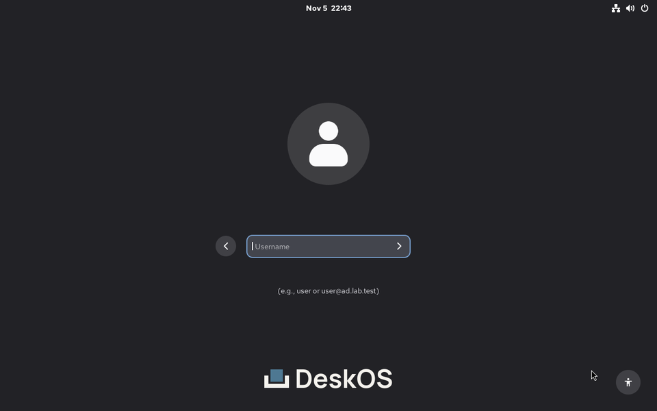
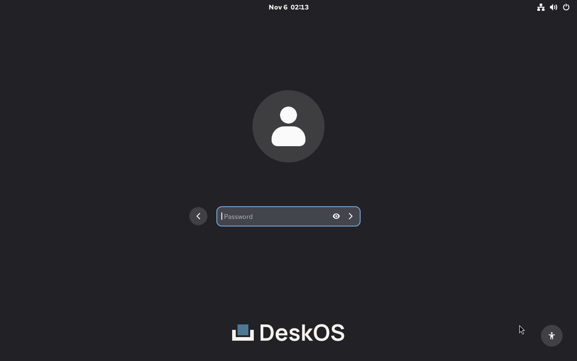
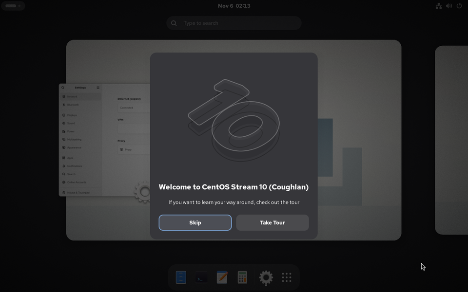

# A corporate desktop that knows who you are

An employee sits at a new workstation, types the account the company already
gave them, and their own home opens. No local user was created for them, no
password was shared with the desk, and the image they booted never held a
credential.

That is what a corporate desktop has to do on the first day, before anything
else on it matters.

## The account is the desktop

The first decision a workstation makes is who is sitting in front of it. If the
answer is a local account with a password someone typed twice, every policy
after it is advice: the screen lock protects a home that was never really the
user's, the audit trail names nobody, and the account outlives the employment
that justified it.

A desktop that starts from the company account gets the rest for free. The home
belongs to the directory user, permissions follow the directory groups, and the
account that opens the session is the one the directory can suspend.

## Three ways to belong

The client image carries the pieces; the organization picks the directory.
DeskOS supports the three arrangements a Linux fleet actually meets.

| Directory | What the user types | What the machine runs |
|---|---|---|
| Active Directory, direct | `qa@ad.example.com` | `sssd-ad` against the domain |
| FreeIPA | `qa@idm.example.com` | `ipa-client`, with HBAC and `sudo` policy |
| FreeIPA with an AD trust | `qa@ad.example.com` | `ipa-client` plus the one-way trust |

The third is the common corporate case: the account lives in AD, the machine is
enrolled in FreeIPA, and SSSD resolves the AD user through the trust. The user
does not know which one they are on.

## What the user sees

The greeter asks for a name, because a list of every employee is not a login
screen. The account authenticates against the directory, and the session begins
in the user's own home.

*The greeter asks for `user@ad.example.com`. The frame comes from the
instrumented boot check, not a mock.*

*PAM and SSSD authenticate the AD account through the trust. The password is
generated per run and never enters the image.*

*The session belongs to the directory user. `oddjob-mkhomedir` created the home
on first login, and `/var/home` carries the `home_root_t` label the SELinux
policy expects.*

## What the administrator keeps

- **The directory stays the source of truth.** DeskOS does not copy users,
  groups or passwords into the image, and does not become a second place to
  deprovision someone.
- **The image carries the client, not the realm.** `ipa-client`, `realmd`,
  `adcli`, `sssd-ad`, `krb5-workstation` and `oddjob-mkhomedir` ship; the realm,
  principal and password arrive at boot, from the machine's own configuration.
- **The join happens before the greeter.** GDM only starts once the account can
  be resolved, so the first login is the directory login and not a local
  workaround.
- **The desktop is typed.** The greeter, the session and the locks are
  `GnomeProfile` fields, reviewed like any other resource, not shell run at boot.

## How we know it works

The repository runs three identity checks every day, at 04:23, 04:47 and 05:43
UTC, and in pull requests that touch the fixtures:

- a DeskOS client enrolled in FreeIPA,
- a DeskOS client joined directly to Active Directory,
- a DeskOS client enrolled in FreeIPA, logging in as a user who lives in AD
  through a cross-forest trust.

Each builds its own image, boots a VM and logs in at the greeter with the
directory password. The checks assert the session user, the home created on
first login, `oddjobd` and the SELinux label on `/var/home`. The trust job also
performs the cross-realm ticket check from the RHEL 10 identity guide.

The fixtures, the assertions and the limits are in
[identity validation](../design/identity-validation.md). The short version:
these are real machines, real Kerberos and real PAM, not a unit test that reads
a configuration file.

## What DeskOS does not do

- **Not enrolment.** A machine joins with a credential that belongs to that
  machine, through the organization's configuration management. Core compiles
  the baseline and does not run a join.
- **Not a directory.** DeskOS holds no realm, no principals and no keytab.
- **Not Active Directory.** The test domain is Samba, which speaks the same
  Kerberos, LDAP, DNS and `sssd-ad` path to the client, without Group Policy or
  Windows replication.
- **Not a policy engine.** Password rules, account lifecycle and access
  decisions stay in AD or FreeIPA, where they already live.

## The point

A workstation without an identity is a login screen, not a corporate desktop.
The company account is the first thing the machine should understand, and the
one thing it should never store.
